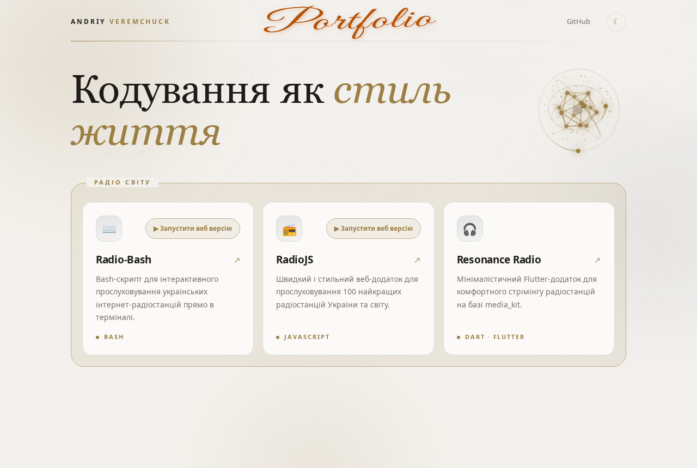

# myPortfolio

Односторінковий лендінг-портфоліо розробника: стримана палітра шампанського золота й графіту, мармурові прожилки, анімований фон і інтерактивна 3D-сцена на canvas.

🔗 **Демо:** https://andriyveremchuck.github.io/

## Можливості

- Верхня навігація з перемикачем світлої/темної теми (враховує `prefers-color-scheme`, вибір зберігається)
- Hero з заголовком і анімованою 3D-сценою: ікосаедр, орбітальні кільця зі слідами, хмара частинок; сцена нахиляється за курсором
- Веб-термінал Radio-Bash (`/radio-bash/`): емулятор bash, що запускає справжній `ukraine-radio.sh` з GitHub, із тим самим меню, клавішами й живим звуком
- Група «Радіо світу» з трьома проєктами: Radio-Bash, RadioJS, Resonance Radio
- Підйом карток і світловий відблиск за курсором при наведенні
- Повільно рухомий фон із розмитих плям і прожилок мармуру
- Адаптивна верстка для мобільних екранів

## Проєкти на сторінці

| Проєкт | Мова | Опис |
|---|---|---|
| [Radio-Bash](https://github.com/AndriyVeremchuck/Radio-Bash) | Bash | Інтерактивне прослуховування українських інтернет-радіостанцій у терміналі |
| [RadioJS](https://github.com/AndriyVeremchuck/RadioJS) | JavaScript | Веб-додаток зі 100 найкращими радіостанціями України та світу |
| [Resonance Radio](https://github.com/AndriyVeremchuck/resonance-radio) | Dart · Flutter | Мінімалістичний застосунок для стрімінгу радіостанцій |

## Запуск

Увесь проєкт — один файл `index.html` без залежностей і збірки. Просто відкрийте його в будь-якому браузері.

## Налаштування

- Ім'я, заголовок і картки проєктів змінюються прямо в HTML
- Акцентний колір і тема задаються CSS-змінними на початку `<style>` (`--accent`, `--bg`, `--surface` та ін.)
